# Physical Verification – SKY130 PDK


| Chapter | Title | File |
|---:|---|---|
| 01 | Introduction to PDK | [Chapter_01_PDK.md](THEORY/Chapter_01_PDK.md) |
| 02 | SKY130 Overview | [Chapter_02_SKY130.md](THEORY/Chapter_02_SKY130.md) |
| 03 | Why SKY130 | [Chapter_03_Why_SKY130.md](THEORY/Chapter_03_Why_SKY130.md) |
| 04 | Libraries | [Chapter_04_Libraries.md](THEORY/Chapter_04_Libraries.md) |
| 05 | Layers | [Chapter_05_Layers.md](THEORY/Chapter_05_Layers.md) |
| 06 | EDA Tools | [Chapter_06_EDA_Tools.md](THEORY/Chapter_06_EDA_Tools.md) |
| 07 | Installation | [Chapter_07_Installation.md](LAB/Chapter_07_Installation.md) |
| 08 | Tool Verification | [Chapter_08_Tool_Verification.md](LAB/Chapter_08_Tool_Verification.md) |
| 09 | Inverter | [Chapter_09_Inverter.md](LAB/Chapter_09_Inverter.md) |
| 10 | Pre-Layout | [Chapter_10_Pre_Layout.md](LAB/Chapter_10_Pre_Layout.md) |
| 11 | Magic Layout | [Chapter_11_Magic_Layout.md](LAB/Chapter_11_Magic_Layout.md) |
| 12 | DRC | [Chapter_12_DRC.md](LAB/Chapter_12_DRC.md) |
| 13 | LVS | [Chapter_13_LVS.md](LAB/Chapter_13_LVS.md) |

## Introduction

This repository documents the study and practical implementation of the SkyWater SKY130 Process Design Kit (PDK).

The documentation covers the fundamentals of semiconductor technology, PDK architecture, libraries, technology files, process layers, devices and open-source EDA tools.

The practical work focuses on designing a CMOS inverter, performing pre-layout simulation, creating its physical layout and carrying out DRC and LVS verification.

# PART 1 – THEORY

# Chapter 01 – Introduction to Process Design Kit (PDK)

## 1.1 What is PDK?

A Process Design Kit (PDK) is a collection of technology-specific files, libraries, device models and design rules provided for a semiconductor manufacturing process.

It acts as an interface between semiconductor fabrication technology and Electronic Design Automation (EDA) tools.

A PDK provides the information required to design, simulate, implement and verify integrated circuits according to the manufacturing process.

## 1.2 Why is PDK Required?

Every semiconductor manufacturing process has its own design limitations and electrical characteristics.

A PDK provides:

- Transistor electrical models.
- Physical layout design rules.
- Technology layer definitions.
- Standard-cell libraries.
- Timing and power information.
- Extraction and verification rules.

Without a suitable PDK, EDA tools cannot accurately interpret the requirements of a particular fabrication technology.


## 1.3 Major Components of PDK

| S. No. | Component | Description |
|---:|---|---|
| 1 | Device Models | Describe the electrical behaviour of transistors and other semiconductor devices. |
| 2 | Technology Files | Define process layers, connectivity and tool-specific configurations. |
| 3 | Design Rules | Specify minimum width, spacing, enclosure and other physical constraints. |
| 4 | Standard-cell Libraries | Provide pre-designed logic cells such as inverters, NAND gates, NOR gates and flip-flops. |
| 5 | Physical Libraries | Contain information required for physical implementation, such as cell dimensions and pin locations. |
| 6 | Verification Files | Provide configurations and rules for DRC, LVS and extraction. |

## 1.4 PDK in VLSI Design

```text
   Semiconductor Process
            |
            v
         PDK Files
            |
            v
         EDA Tools
            |
            v
       Circuit Design
            |
            v
         Simulation
            |
            v
       Physical Layout
            |
            v
     Physical Verification
```

**Key Point:** PDK connects the semiconductor manufacturing process with the IC design environment.

---

# Chapter 02 – Introduction to SKY130 PDK

## 2.1 What is SKY130?

SKY130 is an open-source 130 nm CMOS Process Design Kit developed through collaboration between SkyWater Technology and Google.

It provides process-specific resources for designing and verifying integrated circuits using the SkyWater 130 nm technology.

The PDK includes transistor models, technology files, standard-cell libraries, physical design information and verification resources.

## 2.2 SKY130 Technology Features

- CMOS technology with a 130 nm process class.
- NMOS and PMOS transistor models.
- Multiple metal interconnection layers.
- Digital standard-cell libraries.
- Analog and primitive device libraries.
- Support for open-source EDA tools.

## 2.3 SKY130 PDK Architecture

The SKY130 PDK contains several technology libraries and tool-specific resources.

Important library families include:

| Library | Description |
|---|---|
| sky130_fd_pr | Primitive semiconductor devices |
| sky130_fd_sc_hd | High-density standard cells |
| sky130_fd_sc_hdll | High-density low-leakage cells |
| sky130_fd_sc_hs | High-speed standard cells |
| sky130_fd_io | Input/output cells |

## 2.4 SKY130 PDK Directory Structure

The PDK installation generally contains the following resources:

```text
sky130A/
│
├── libs.ref/
│   ├── sky130_fd_pr/
│   ├── sky130_fd_sc_hd/
│   └── sky130_fd_io/
│
├── libs.tech/
│   ├── magic/
│   ├── netgen/
│   ├── ngspice/
│   └── xschem/

```

The exact contents depend on the PDK version and installation method.

**Key Point:** `libs.ref` contains reference library data, while `libs.tech` contains technology and tool integration resources.

---

# Chapter 03 – Why SKY130 PDK?

## 3.1 Why Choose SKY130?

SKY130 provides an accessible environment for understanding real semiconductor design concepts without depending entirely on proprietary design tools.

It is particularly useful for students and researchers interested in CMOS design and physical verification.

---

# Chapter 04 – SKY130 Libraries and Technology Files

## 4.1 What are PDK Libraries?

PDK libraries contain the electrical and physical information required by EDA tools to design and implement integrated circuits.

They describe semiconductor devices, digital cells and their technology-dependent characteristics.

## 4.2 Types of Libraries

### A. Primitive Device Library

`sky130_fd_pr`

Contains basic semiconductor devices such as:

- NMOS transistors.
- PMOS transistors.
- Resistors.
- Capacitors.
- Diodes.

### B. Standard-cell Library

`sky130_fd_sc_hd`

Contains pre-designed digital logic cells.

Examples:

- Inverter.
- NAND gate.
- NOR gate.
- AND gate.
- OR gate.
- Flip-flop.
- Buffer.

### C. I/O Library

`sky130_fd_io`

Contains input/output cells used for interfacing internal circuit signals with external connections.

## 4.3 Important Technology File Formats

| File | Description |
|---|---|
| `.lib` | Timing and power information |
| `.lef` | Physical cell abstracts |
| `.gds` | Physical layout geometry |
| `.spice` | Electrical circuit and device models |
| `.cdl` | Circuit connectivity description |
| `.mag` | Magic layout database |
| `.tech` | Technology configuration |

## 4.4 Liberty File (.lib)

A Liberty file describes the electrical and timing characteristics of standard cells.

It contains information such as:

- Cell name.
- Input and output pins.
- Timing arcs.
- Power characteristics.
- Capacitance.
- Operating conditions.

---

# Chapter 05 – SKY130 Process Layers

## 5.1 What are Process Layers?

Process layers represent the different semiconductor materials and structures used during IC fabrication.

They define transistor regions, contacts and metal interconnections.

## 5.2 Important SKY130 Layers

| Layer | Function |
|---|---|
| nwell | N-type well formation |
| active | Active semiconductor region |
| nplus | N-type implant |
| pplus | P-type implant |
| poly | Polysilicon gate |
| licon | Local interconnect contact |
| li1 | Local interconnect |
| mcon | Metal contact |
| met1 | Metal 1 |
| via | Metal interconnection |
| met2 | Metal 2 |
| via2 | Metal 2 to Metal 3 connection |
| met3 | Metal 3 |
| via3 | Metal 3 to Metal 4 connection |
| met4 | Metal 4 |
| via4 | Metal 4 to Metal 5 connection |
| met5 | Metal 5 |

## 5.3 Front-end Layers

Front-end layers are mainly involved in forming semiconductor devices.

Examples:

- N-well.
- Active region.
- Implant layers.
- Polysilicon.
- Device isolation structures.

## 5.4 Back-end Layers

Back-end layers are mainly used for electrical interconnections.

Examples:

- Local interconnect.
- Contacts.
- Metal layers.
- Vias.

## 5.5 Metal Interconnection

SKY130 provides five main metal routing layers.

Metal layers are connected through vias to create electrical paths between different parts of the circuit.

**Key Point:** Correct layer selection and connectivity are essential for physical layout and DRC verification.

---

# Chapter 06 – Open-source EDA Tools

## 6.1 What are EDA Tools?

Electronic Design Automation tools are software applications used to design, simulate, implement and verify integrated circuits.

## 6.2 Tools Used in This Project

| S. No. | EDA Tool | Description |
|---:|---|---|
| 1 | Xschem | Schematic capture tool |
| 2 | Ngspice | Circuit simulation tool |
| 3 | Magic VLSI | VLSI layout editor |
| 4 | Netgen | LVS verification tool |
| 5 | KLayout | Layout viewer and editor |

## 6.3 Tool Flow

```text
          Xschem
      Schematic Design
             |
             v
          Ngspice
     Circuit Simulation
             |
             v
           Magic
      Physical Layout
             |
             v
            DRC
             |
             v
      Netlist Extraction
             |
             v
           Netgen
             |
             v
            LVS
```

---

# PART 2 – LABORATORY

# Chapter 07 – SKY130 PDK Installation

## 7.1 Objective

To install and configure the SKY130 PDK environment in Ubuntu Linux.

## 7.2 Installation

```bash
git clone https://github.com/RTimothyEdwards/open_pdks.git
cd open_pdks
./configure --enable-sky130-pdk
make
sudo make install
```

## 7.3 Configure PDK Environment

```bash
export PDK_ROOT=/path/to/pdks
export PDK=sky130A
```

Replace the path with the actual PDK installation directory.

## 7.4 Verify Environment

```bash
echo $PDK_ROOT
echo $PDK
```

---

# Chapter 08 – EDA Tool Verification

## 8.1 Objective

To verify the installation and accessibility of the EDA tools required for SKY130 circuit design and physical verification.

## 8.2 Tool Verification

Execute the following commands in the Ubuntu terminal.

### Xschem

```bash
xschem -version
```
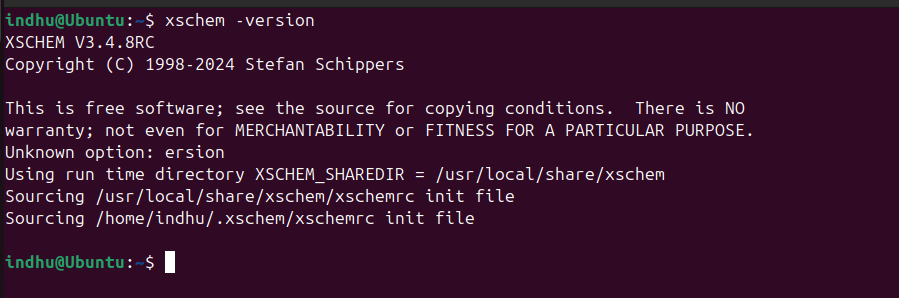
### Ngspice

```bash
ngspice --version
```
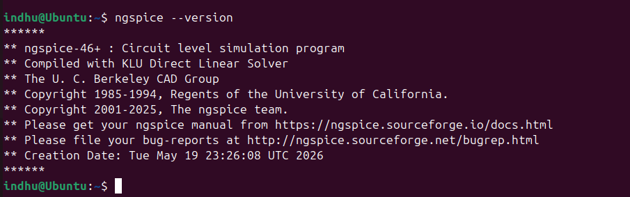

### Magic

```bash
magic --version
```
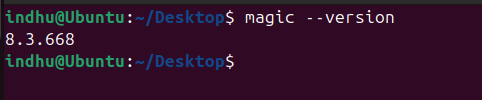
### Netgen

```bash
netgen -batch
```
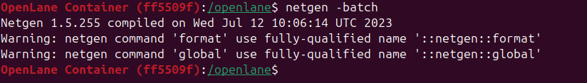
### KLayout

```bash
klayout -v
```

## 8.3 PDK Verification

```bash
echo $PDK_ROOT
echo $PDK
```
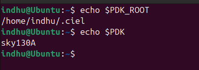

Check whether the required SKY130 technology files are available.

## 8.4 Observation

Record the installed tool versions and verify that each tool can access the correct SKY130 resources.

**Result:** The EDA environment is ready for the CMOS inverter experiment after successful installation and integration checks.

---

# Chapter 09 – CMOS Inverter Design

## 9.1 Objective

To design a CMOS inverter using SKY130 NMOS and PMOS transistor models.

## 9.2 Theory

A CMOS inverter is a basic digital logic circuit consisting of one PMOS transistor and one NMOS transistor.

The PMOS acts as a pull-up device, while the NMOS acts as a pull-down device.

Both transistor gates are connected to the input, and their drains are connected to the output.

## 9.3 Circuit Connections

- PMOS source and body connect to the appropriate positive supply.
- NMOS source and body connect to ground.
- Both gates form the input.
- Both drains form the output.

## 9.4 Working Principle

**Case 1 – Input LOW**

When the input is LOW, the PMOS turns ON and the NMOS turns OFF. The output becomes HIGH.

**Case 2 – Input HIGH**

When the input is HIGH, the PMOS turns OFF and the NMOS turns ON. The output becomes LOW.

## 9.5 Truth Table

| Input (A) | Output (Y) |
|---|---|
| 0 | 1 |
| 1 | 0 |

## 9.6 Boolean Expression

```text
Y = A'
```

## 9.7 Observation

The output logic level is the inverse of the input logic level.

**Result:** A CMOS inverter schematic is designed using SKY130 transistor devices.

---

# Chapter 10 – Pre-layout Design and Simulation

## 10.1 Objective

To verify the electrical functionality of the CMOS inverter before physical layout implementation.

## 10.2 Schematic Creation Using Xschem

1. Launch Xschem.
2. Create a new schematic.
3. Select SKY130 PMOS and NMOS devices.
4. Connect the transistor terminals.
5. Add supply and input voltage sources.
6. Connect the output node.
7. Generate the SPICE netlist.

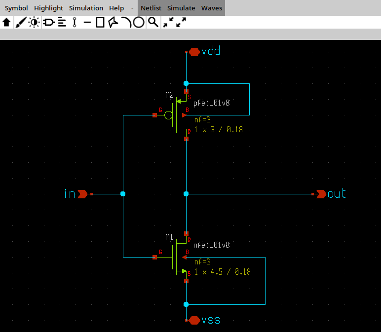

## 10.3 Symbol by Schematic
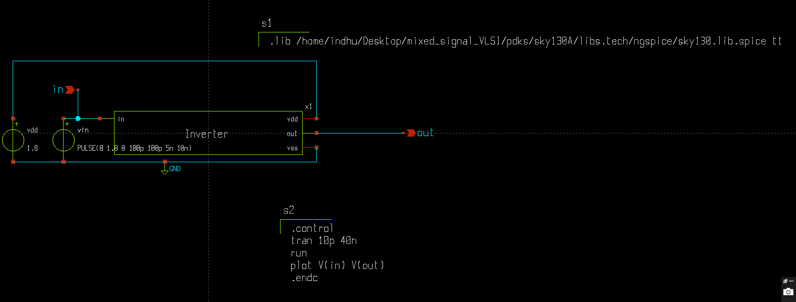
## 10.4 Netlist Generation

Generate the SPICE netlist from the completed schematic.

The generated netlist contains the transistor connections, model references and circuit parameters required for simulation.

## 10.5 Simulation Using Ngspice


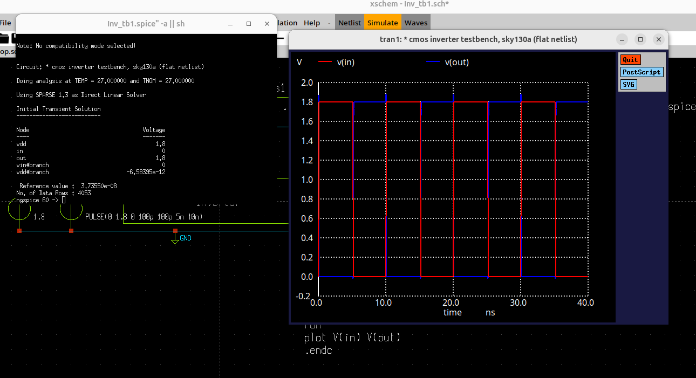

## 10.6 Observation

The output waveform should show inverted logic behaviour relative to the input.

**Result:** The CMOS inverter functionality is verified through pre-layout SPICE simulation.

---

# Chapter 11 – Physical Layout Using Magic

## 11.1 Objective

To create the physical layout of the CMOS inverter using Magic VLSI and SKY130 technology.

## 11.2 Introduction to Layout

Physical layout represents the actual geometric structures used to implement an integrated circuit.

It includes transistor regions, wells, contacts, interconnections and metal routing.

## 11.3 Layout Implementation

1. Launch Magic with SKY130 technology.
2. Create a new layout cell.
3. Draw the PMOS and NMOS structures.
4. Define the active regions.
5. Create polysilicon gates.
6. Add contacts and local interconnect.
7. Connect source and drain terminals.
8. Route the input and output.
9. Connect power and ground.
10. Save the layout.

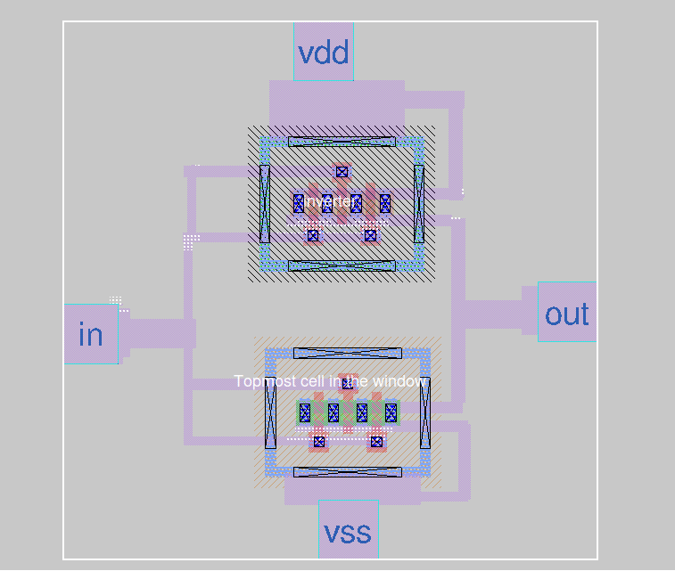

## 11.4 Observation

Inspect the layout geometry, transistor connections and routing.

**Result:** The physical layout of the CMOS inverter is created using Magic.

---

# Chapter 12 – Design Rule Checking (DRC)

## 12.1 What is DRC?

Design Rule Checking is a physical verification process used to check whether the layout satisfies the manufacturing design rules of the selected technology.

Each semiconductor process has specific geometric constraints that must be followed during layout design.

## 12.2 Why is DRC Required?

DRC helps identify layout errors before fabrication.

It checks whether the physical structures follow the required dimensions and spacing constraints.

## 12.3 Common DRC Rules

**Minimum Width:** Ensures that a layout shape has sufficient width.

**Minimum Spacing:** Ensures that different shapes have sufficient separation.

**Enclosure:** Ensures that contacts and vias are properly surrounded by the required layer.

**Minimum Area:** Ensures that a polygon satisfies the minimum area requirement.

**Well Rules:** Checks well dimensions, spacing and related constraints.

## 12.4 DRC Using Magic

Open the inverter layout in Magic and execute:

```tcl
drc check
drc count
```

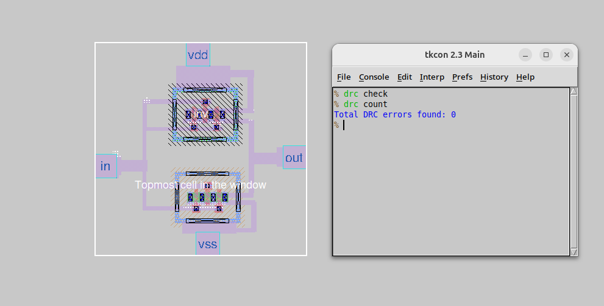

## 12.5 Observation

Record the violations detected before correction and the final verification status.

**Result:** The CMOS inverter layout is checked against the applicable SKY130 design rules.

---

# Chapter 13 – Layout Versus Schematic (LVS)

## 13.1 What is LVS?

Layout Versus Schematic is a physical verification process that compares the electrical connectivity of a physical layout with its reference schematic.

It ensures that the implemented layout represents the intended circuit.

## 13.2 Why is LVS Required?

A layout may satisfy all geometric design rules but still contain incorrect electrical connections.

LVS identifies such differences by comparing the extracted layout netlist with the reference schematic netlist.

## 13.3 LVS Verification Process

**Reference Netlist:** Generated from the original schematic.

**Layout Extraction:** Extracts devices and electrical connections from the physical layout.

**Netlist Comparison:** Netgen compares both netlists.

**Mismatch Analysis:** Identifies differences in device structure, properties and connectivity.

## 13.4 Common LVS Errors

- Missing devices.
- Extra devices.
- Incorrect net connections.
- Device parameter mismatches.
- Incorrect pin names.
- Incorrect bulk connections.

## 13.5 LVS Using Netgen

Example command structure:

```bash
netgen -batch lvs \
"/path/to/reference/inverter.spice inverter" \
"/path/to/extracted/inverter.spice inverter" \
"$PDK_ROOT/sky130A/libs.tech/netgen/sky130A_setup.tcl" \
lvs_report.txt
```

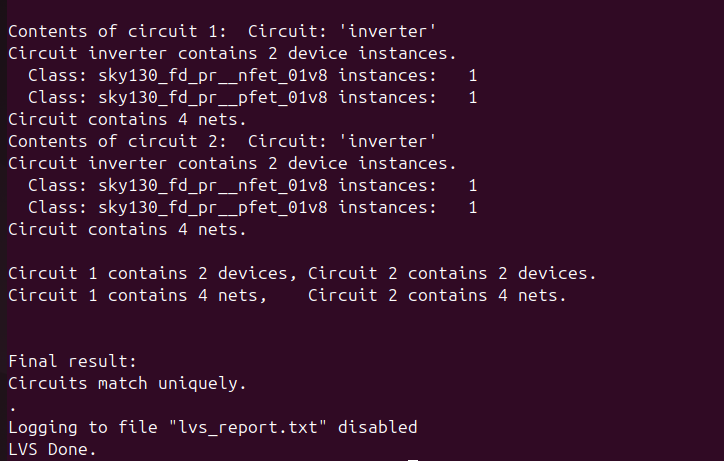

## 13.6 Observation

Record the number of devices, nets, mismatches and the final LVS comparison result.

**Result:** The extracted layout netlist is compared with the reference schematic to establish electrical equivalence.

---

# Final Conclusion

This repository documents the fundamentals of SKY130 PDK and its practical application in CMOS inverter design.

The experiments provide an understanding of transistor-level circuit design, SPICE simulation, physical layout generation, design rule checking and layout-versus-schematic verification.

The complete workflow demonstrates the connection between circuit design and physical implementation using open-source EDA tools.

# References

1. https://skywater-pdk.readthedocs.io/en/main/
2. https://github.com/google/skywater-pdk
3. http://opencircuitdesign.com/magic/
4. https://ngspice.sourceforge.io/
5. http://opencircuitdesign.com/netgen/
6. https://xschem.sourceforge.io/
